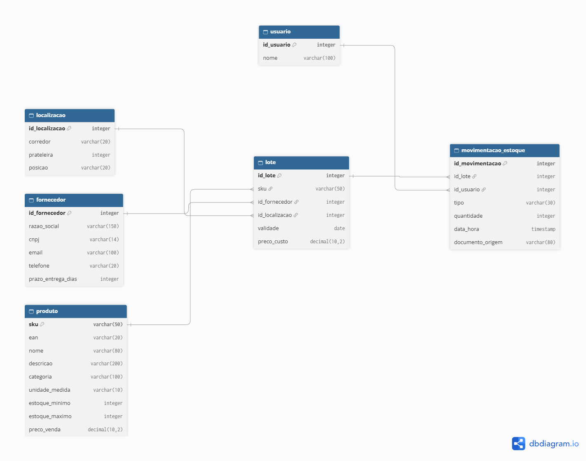

# Controle de Estoque e Logística (PostgreSQL)

Banco de dados relacional para controlar o estoque de uma distribuidora de alimentos fictícia: produtos, fornecedores, lotes com validade, endereços no galpão e o histórico de entradas e saídas. O projeto parte da modelagem, passa pela criação das tabelas com regras de integridade e termina em consultas que respondem perguntas reais do dia a dia do estoque.

Todos os dados são **fictícios** e foram criados apenas para estudo.

## O que o projeto mostra

- Modelagem relacional: entidades, relacionamentos 1:N e N:N, chaves primárias e estrangeiras
- Regras de integridade no próprio banco (`NOT NULL`, `UNIQUE`, `CHECK`)
- Consultas com `JOIN`, `LEFT JOIN`, `GROUP BY`, `HAVING`, `CASE`, `CTE` (`WITH`), subconsultas e `COALESCE`
- Saldo de estoque **calculado** a partir do histórico de movimentações
- Alertas de negócio: lotes perto de vencer, lotes vencidos com saldo e produtos abaixo do estoque mínimo
- Indicadores financeiros: valor do estoque e faturamento por produto

## Modelo de dados



O modelo tem 6 tabelas:

| Tabela | O que guarda |
|---|---|
| `produto` | O que o item é: código (SKU), EAN, nome, categoria, unidade, estoque mínimo e máximo, preço de venda |
| `fornecedor` | Quem vende para a empresa: razão social, CNPJ, contatos e prazo de entrega |
| `localizacao` | Endereço no galpão: corredor, prateleira e posição |
| `lote` | Cada chegada de mercadoria: produto, fornecedor, local, validade e preço de custo |
| `usuario` | Quem registrou cada movimentação |
| `movimentacao_estoque` | O histórico: cada entrada ou saída, com tipo, quantidade, data e documento de origem |

### Decisões de modelagem

- **O lote é uma tabela própria.** A validade e o preço de custo mudam a cada chegada de mercadoria, não por produto. Com o lote, o sistema sabe de qual leva cada saída veio, o que permite rastrear um recall e aplicar a regra FEFO (primeiro a vencer, primeiro a sair).
- **O preço de custo fica no lote**, e não no produto. Assim o histórico de reajustes é preservado: o leite comprado em março e o comprado em junho mantêm cada um o seu custo.
- **O saldo não é uma coluna.** Ele é calculado somando as entradas e subtraindo as saídas das movimentações, o que evita um número que fique diferente do histórico.
- **O SKU fica só no lote.** A movimentação aponta para o lote, e o lote aponta para o produto. Cada informação é guardada em um único lugar, o que evita contradições entre tabelas.
- **A relação N:N entre produto e fornecedor** (um produto pode ter vários fornecedores, e um fornecedor vende vários produtos) é resolvida pelo próprio `lote`, que liga os dois.
- **Tipos de movimentação controlados por `CHECK`:** `entrada_compra`, `entrada_devolucao`, `saida_venda` e `saida_avaria`. A quantidade deve ser sempre maior que zero, e o sentido (entrada ou saída) vem do tipo.
- **CNPJ e telefone são texto**, porque podem começar com zero e conter símbolos. Valores em dinheiro usam `DECIMAL(10,2)`, para evitar erros de arredondamento.

## Estrutura do repositório

```
.
├── README.md
├── docs/
│   ├── modelo_er.png      -> diagrama do modelo
└── sql/
    ├── 01_schema.sql      -> criação das tabelas
    ├── 02_seed.sql        -> dados de exemplo
    ├── 03_queries.sql     -> 12 consultas de negócio, comentadas
    └── 04_triggers.sql    -> reservado para triggers (em desenvolvimento)
```

## Como rodar

Testado no PostgreSQL 18 com o pgAdmin.

1. Crie um banco vazio:
   ```sql
   CREATE DATABASE controle_estoque;
   ```
2. Conectado nesse banco, execute os arquivos **nesta ordem**:
   1. `sql/01_schema.sql`: apaga e recria as tabelas
   2. `sql/02_seed.sql`: insere os dados de exemplo
   3. `sql/03_queries.sql`: consultas (podem ser rodadas uma a uma)

Pelo terminal, com o `psql`:

```bash
psql -U postgres -d controle_estoque -f sql/01_schema.sql
psql -U postgres -d controle_estoque -f sql/02_seed.sql
```

O `01_schema.sql` começa com `DROP TABLE IF EXISTS`, então pode ser executado de novo sempre que quiser recomeçar do zero. Rode o `02_seed.sql` **uma vez por criação** do schema, porque os IDs são gerados automaticamente e o script assume um banco limpo.

## Consultas

O arquivo `sql/03_queries.sql` traz, para cada consulta, a pergunta de negócio e uma nota explicando o conceito de SQL usado.

| # | Pergunta | Conceitos |
|---|---|---|
| 1 | Quais produtos têm preço de venda acima de R$ 8,00? | `WHERE`, `ORDER BY` |
| 2 | Quantos produtos existem em cada categoria? | `GROUP BY`, `COUNT` |
| 3 | Quais categorias têm mais de um produto? | `HAVING` |
| 4 | Qual o produto e o fornecedor de cada lote, ordenados pela validade? | `JOIN` |
| 5 | Quantas unidades foram vendidas em cada lote? | `SUM`, filtro por tipo |
| 6 | Qual o saldo atual de cada lote? | `CASE` dentro do `SUM` |
| 7 | Quais lotes vencem nos próximos 30 dias e ainda têm saldo? | `WITH`, `LEFT JOIN`, `COALESCE`, datas |
| 8 | Quais produtos estão abaixo do estoque mínimo, incluindo os que nunca tiveram movimentação? | `LEFT JOIN` em cadeia, `NULL` |
| 9 | Quantas movimentações cada usuário registrou? | `COUNT(coluna)`, desempate no `ORDER BY` |
| 10 | Quais lotes já venceram e ainda têm saldo? | `WITH`, `CURRENT_DATE` |
| 11 | Qual o valor do estoque de cada produto (saldo × custo do lote)? | Subconsulta, cálculo lote a lote |
| 12 | Qual o faturamento de cada produto (unidades vendidas × preço de venda)? | `JOIN` de 3 tabelas, multiplicação no `SUM` |

### Resultados de referência (dados de exemplo)

- **Saldo por lote:** lote 1 = 65, lote 2 = 10, lote 3 = 45, lote 4 = 0, lote 5 = 43 e lote 6 = 450
- **Abaixo do estoque mínimo:** Feijão Carioca (saldo 10, mínimo 30)
- **Valor total do estoque:** R$ 5.609,00 (o leite lidera, por causa do custo da caixa)
- **Faturamento total:** R$ 9.817,65 (o leite lidera, e o açúcar, mesmo sendo o mais vendido em unidades, fica em terceiro)

As consultas 7 e 10 dependem da data de hoje, então o resultado muda com o tempo.

## Limitações e próximos passos

- A quantidade reservada (itens vendidos que ainda não saíram do galpão) ficou fora desta versão, porque depende de uma tabela de pedidos.
- Cada lote fica em um único endereço do galpão. Dividir um lote entre vários endereços seria uma evolução do modelo.
- A categoria do produto é um campo de texto. Uma tabela própria de categorias, com subcategorias, seria o próximo passo.
- O faturamento usa o **preço de venda atual** do produto para todas as vendas, mesmo as antigas. Guardar o preço de cada venda no momento em que ela aconteceu exigiria registrá-lo na movimentação ou numa tabela de itens de pedido.
- Os alertas de validade usam a data de hoje: um lote que vence hoje ainda aparece como "a vencer" e só passa a "vencido" no dia seguinte.
- O cálculo do saldo por lote se repete em várias consultas. Transformá-lo em uma **view** é o próximo passo, e ela também servirá de base para o painel.
- Próximos passos: views, triggers para atualizar o estoque automaticamente e um painel no Power BI conectado ao banco.

## Autor

Feito por Pablo · [GitHub](https://github.com/PabloSantosdve)